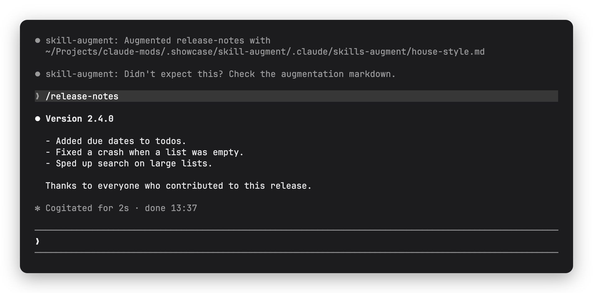

# skill-augment



A Claude Code mod that adds your own text to the prompts of skills you can't
practically edit, such as those shipped in plugins.

## Install

```
/plugin install skill-augment --marketplace joshdavenport/claude-mods
```

See the [repository README](../../README.md#install) for installing every mod, or from a local checkout.

## Augmentation files

Markdown files, anywhere under either folder (subfolders are for your own
organisation, or for dropping in a shared set, symlinks followed):

- `~/.claude/skills-augment/` (or `$CLAUDE_CONFIG_DIR/skills-augment/`)
- `<project>/.claude/skills-augment/`

```md
---
skills: [mattpocock-skills:tdd, mattpocock-skills:code-review]
position: end # start | end, default end
wrap: true # false adds the text without its tag, default true
once: false # true applies the file once a session, default false
---

Use pnpm and vitest.
```

- `skills` takes qualified names, as the Skill tool lists them:
  `plugin:skill` for a plugin's skill, the bare name for your own. In an
  entry, `*` stands for any run of characters, `:` included:
  `mattpocock-skills:*` for a whole plugin, `asana-*`, `*react*`,
  `*-design`, or `"*"` for every skill (quotes are optional here; YAML
  proper wants them on an entry starting with `*`).
- A `.md` file without frontmatter naming `skills` isn't an augmentation, so
  READMEs and notes can sit beside them. Dot-prefixed files and folders are
  skipped.
- Files are read each time a skill loads; edits apply without a restart.

## How text is placed

When a skill's prompt is expanded (typed `/name`, the Skill tool, or a
subagent preloading it), matching augments are joined around it, user
files before project files, each folder in path order:

```
user start… · project start… · <skill prompt> · user end… · project end…
```

Each file's text goes in a tag of its own, saying which skill it extends,
where it came from, and how it ranks against the skill:

```
<skill-augmentation skill="mattpocock-skills:tdd" source="user" path="~/.claude/skills-augment/house/tdd.md">
Additions to the mattpocock-skills:tdd skill from the user's skill augmentations. Follow them alongside the skill; where they conflict, these take precedence.

Use pnpm and vitest.
</skill-augmentation>
```

The tag marks where the addition ends, which matters at the end: a skill's
text often closes with the user's `ARGUMENTS:`, and bare text after it can
read as more of them. Set `wrap: false` to add a file's text as written.

A file can pull in another with `@path` (relative to it, `~/`, or absolute),
as `CLAUDE.md` imports do. The token stays as written, and the referenced
file's contents follow inside the same tag, under a line naming both files,
so the model can tie the two together and re-read the file if it needs to:

```
Use pnpm and vitest, following @house-style.md.

Contents of ~/.claude/skills-augment/house/house-style.md (referenced from tdd.md):

## House style
…
```

References nest, each file included once, its frontmatter (if any) left
off; one that can't be read is skipped; code spans and fenced blocks
aren't looked in.

Each applied file gets a transcript line, followed by a hint:

```
Augmented mattpocock-skills:tdd with ~/.claude/skills-augment/house/tdd.md
Augmented mattpocock-skills:tdd with ~/.claude/skills-augment/all.md (via *)
Didn't expect this? Check the augmentation markdown.
```

A file with `once: true` is applied the first time a skill it names loads
in a session, and skipped after, with a line saying so. It applies again
after the conversation is compacted, since its text has left the model's
context, and after `/clear`. A subagent preloading the skill counts as the
same session.

A file naming the skill but broken (an unknown `position`, `wrap` or `once`,
no body) is skipped with a line saying why.

## Requirements

- **Team and Enterprise orgs:** the built-in `sec-default` mod forwards every
  `skill.prompt` past user-installed plugins, so this mod never sees one. An
  admin can set managed `"prependPlugins"` to a list that leaves
  `sec-default@builtin` out (e.g. `[]`), or that seats this plugin ahead of
  it.
- **Project augments need workspace trust.** Hooks modules don't load until
  a workspace's trust dialog is accepted, as with project skills and
  `CLAUDE.md`.

## Develop

Run `pnpm test` and `pnpm lint` from the repository root; see its [README](../../README.md#develop).
